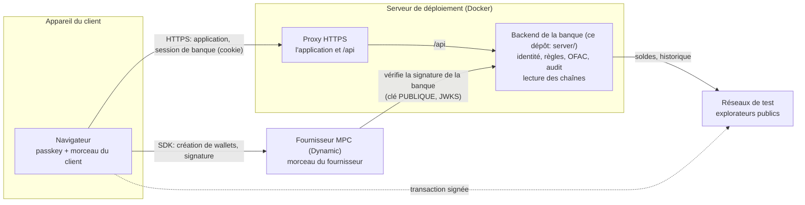
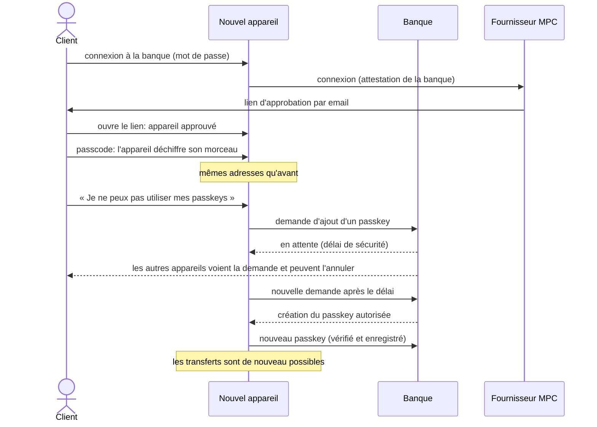

# creeps

Un wallet crypto qu'une banque (Swissquote) pourrait offrir à ses clients, où **le client garde le contrôle de ses actifs** et où **la banque ne peut jamais signer à sa place**.

Prototype pour le Swissquote Wallet Challenge. **Réseaux de test uniquement** : Bitcoin testnet, Base Sepolia (Ethereum), Solana testnet. Aucun fonds réel.

## L'idée en une phrase

Au lieu d'une seed phrase (12 mots à noter), la clé du wallet est **coupée en morceaux** et **personne ne la possède en entier**. Pour signer une transaction, il faut le morceau du client **et** le morceau du fournisseur, et le fournisseur n'accepte de signer que **si la banque l'y autorise**.

## Qui détient quoi

| Acteur | Ce qu'il détient | Ce qu'il peut faire |
|---|---|---|
| **Le client** | Un morceau de clé sur son appareil, protégé par son **passcode**. Son **passkey** (empreinte / visage), enregistré auprès de la banque | Se connecter, approuver une transaction, exporter sa clé |
| **Le fournisseur MPC** (Dynamic) | L'autre morceau de clé | Participer à la signature, jamais seul, et **seulement avec l'autorisation de la banque** |
| **La banque** (Swissquote) | Aucun morceau de clé. Les passkeys du client (leur partie publique) | Vérifier l'identité et les passkeys, appliquer ses règles, **autoriser ou refuser** chaque signature |

Conséquence : si la banque ou le fournisseur est piraté, l'attaquant n'a **qu'un morceau**, ce qui ne suffit pas à signer.

## Les mots à connaître

- **MPC** (calcul multipartite) : technique qui permet de signer avec plusieurs morceaux de clé **sans jamais les réunir**.
- **Passkey** : connexion par empreinte, visage ou verrouillage d'écran (WebAuthn). Il est enregistré **auprès de la banque**: il permet de se connecter sans mot de passe et d'approuver chaque transfert. La partie secrète ne quitte jamais l'appareil.
- **Passcode** : mot de passe choisi par le client, qui chiffre son morceau de clé. **Personne d'autre que lui ne le connaît.**
- **Testnet** : réseau d'essai, les pièces n'ont aucune valeur.
- **OFAC** : liste de sanctions publiée par le Trésor américain, contre laquelle la banque contrôle chaque adresse de destination.

## Architecture



Le backend de la banque n'a **aucun** morceau de clé et ne signe aucune transaction. Il fait six choses :

1. **Authentifier** le client, par mot de passe (essais limités) **ou par passkey**, et **attester de son identité** auprès du fournisseur par un jeton signé.
2. **Gérer les passkeys** (WebAuthn, vérifié côté serveur): le premier tout de suite; un second tout de suite si un passkey vient d'être vérifié; en cas d'appareil perdu, après un **délai de sécurité** pendant lequel le client peut annuler depuis un autre appareil.
3. **Contrôler chaque transfert avant la signature** : liste de sanctions OFAC, plafond par transfert, plafond sur 24 h, liste d'adresses approuvées.
4. **Autoriser la signature** : après le passkey du client, lié au transfert qu'elle vient de valider, la banque remet au fournisseur un jeton court sans lequel il refuse de signer (même chose pour exporter la clé). Une décision de la banque ne sert qu'une fois.
5. **Tenir un journal d'audit** à chaîne de hachage : modifier ou supprimer une ligne casse la chaîne, et c'est détecté.
6. **Lire les réseaux de test** (soldes, historique, frais) pour le compte du client.

## Comment ça fonctionne

### 1. Création du wallet

1. Le client crée son compte de banque (mot de passe) puis se connecte.
2. Il choisit un **passcode**.
3. L'application demande au fournisseur de créer **trois wallets** (Bitcoin, Ethereum, Solana). La clé de chacun est générée **directement en morceaux**.
4. Le client crée son **premier passkey** (empreinte ou visage); la banque le vérifie et l'enregistre.

### 2. Envoyer des fonds

1. Le client saisit une adresse et un montant.
2. La **banque contrôle** : adresse sanctionnée ou non, plafonds, liste blanche. Si c'est refusé, rien ne part, et la décision est enregistrée.
3. Si c'est accepté, le client confirme avec son **passkey**. La banque le vérifie et remet au **fournisseur** une autorisation à usage unique, liée à ce transfert.
4. Son morceau et celui du fournisseur **signent ensemble**. Sans l'autorisation de la banque, le fournisseur refuse (HTTP 403).
5. La transaction est diffusée sur le réseau de test ; la banque est informée du résultat pour que l'audit relie la décision et la transaction.

### 3. Perte de l'appareil : récupérer son wallet



Si les passkeys du client sont **synchronisés** entre ses appareils (gestionnaire de mots de passe du système), le nouvel appareil les a déjà : aucune récupération n'est nécessaire. La banque ne connaît pas le passcode : elle ne peut ni signer ni déchiffrer. **S'il perd son passcode, le wallet n'est pas récupérable** : c'est le prix du self-custody.

### 4. Exporter sa clé

Le client peut sortir de la banque avec sa clé : passkey **obligatoire** (la banque remet alors une autorisation d'export, jamais sur simple mot de passe) et passcode. Le fournisseur affiche la clé dans un cadre isolé de la page.

## Organisation du code

```
app/                       application web (React + TypeScript + Vite)
  src/Landing.tsx          page d'accueil
  src/App.tsx              application: vue d'ensemble, envoi et réception, historique, profil
  src/access/              parcours d'accès: connexion (mot de passe ou passkey), appareil, passcode, passkeys, délai de sécurité (testés)
  src/provider/            moteur de wallet derrière l'interface WalletProvider (fournisseur remplaçable)
  src/bank/                client HTTP du backend de la banque, et appel WebAuthn du navigateur
  src/chain/               soldes et historique, via la banque
  src/proof/               vérification locale d'une signature (EVM, Solana, Bitcoin)
  src/testing/             doubles utilisés uniquement par les tests
  scripts/bank-tunnel.mjs  tunnel SSH vers le socket d'administration du backend
server/                    backend de la banque (Node, aucune dépendance npm)
  src/                     comptes, jetons, passkeys (webauthn.mjs), règles, OFAC, audit, lecture des chaînes
  test/                    tests du backend
  Dockerfile, docker-compose.yml   déploiement
scripts/deploy.sh          déploie la banque (conteneur) et l'application (fichiers statiques)
```

## Ce qui est démontré, et ce qui ne l'est pas

| Fonction | Statut |
|---|---|
| Backend de la banque : comptes, jetons signés, passkeys WebAuthn, contrôle OFAC réel, audit à chaîne de hachage, lecture des chaînes, limites de débit | Testé (82 tests, cryptographie vérifiée avec un authentificateur logiciel réel), déployé |
| Application et banque en ligne, en HTTPS, sur un même domaine, sans service tiers hormis le fournisseur de wallet | Déployé, contrôlé dans un vrai navigateur |
| Parcours d'accès et écrans : appareil connu, nouvel appareil, passkeys, récupération avec délai, invite refusée, banque coupée, envoi, export, historique, règles | Testé avec des doubles (61 tests) |
| Création de 3 wallets MPC, connexion du fournisseur avec le jeton de la banque, approbation d'un appareil par email | Vérifié sur le vrai fournisseur |
| Signature MPC sur Bitcoin (BIP-322), Ethereum et Solana, vérifiée sur l'appareil | Vérifiée sur le vrai fournisseur |
| **Le fournisseur refuse de signer sans l'autorisation de la banque** | Vérifié sur le vrai fournisseur (403 sans jeton, signature avec) |
| Passkeys de la banque : création, délai de sécurité d'un appareil perdu, connexion sans mot de passe, autorisations de signer et d'exporter | Vérifié sur le site déployé, avec un vrai navigateur (la banque seule) |
| Création du compte, des wallets et du passkey, puis signature avec passkey de bout en bout dans l'interface (Ethereum), avec le dashboard du fournisseur réglé comme décrit plus bas | Vérifié sur le vrai fournisseur. Le fournisseur n'offre alors **aucune** autre voie d'élévation que la banque, et refuse (403) sans jeton ou avec un faux |
| Connexion par passkey suivie de la session du fournisseur | À confirmer sur le vrai fournisseur (la partie banque est vérifiée) |
| Récupération sur un nouvel appareil : déverrouillage par passcode chez le fournisseur, puis nouveau passkey | Passkey et délai vérifiés ; le déverrouillage par passcode sur un appareil neuf reste **à confirmer** |
| Export de la clé privée (passkey + passcode) | Implémenté, testé avec des doubles ; à confirmer sur le vrai fournisseur |
| Envoi réel de transactions | Implémenté, garde sur le réseau de test ; à éprouver avec des fonds de test |
| Autorisation liée à la transaction exacte | **Limite connue** : la banque autorise un transfert qu'elle a contrôlé, mais le fournisseur ne vérifie pas les octets signés. Le réglage « usage unique » du fournisseur est nécessaire, et un contrôle a posteriori du réseau reste à faire |
| Login Swissquote réel | Remplacé par un mot de passe (ou un passkey) sur un serveur de test |
| Frais de transaction pris en charge par la banque | Reporté |

## Démarrage

Il faut Node 22.13 ou plus.

**Application** (utiliser `localhost`, jamais `127.0.0.1` : les passkeys refusent les adresses IP) :

```
cd app
cp .env.example .env    # renseigner VITE_DYNAMIC_ENVIRONMENT_ID
npm install
npm run dev             # accueil: http://localhost:5173   application: http://localhost:5173/#app
npm test                # parcours d'accès, écrans, vérification des signatures
```

Le serveur de développement relaie `/api` vers la banque : par défaut `http://127.0.0.1:8787` (backend local, ou tunnel SSH, voir plus bas). Pour développer l'interface contre une banque déjà déployée, renseigner `BANK_URL=https://...` dans `app/.env` ; cette banque doit alors autoriser l'origine `http://localhost:5173` (réglage `BANK_ALLOWED_ORIGINS`).

**Backend de la banque en local** :

```
cd server
npm test                # tests du backend
npm start               # API sur 127.0.0.1:8787, clé JWKS sur 127.0.0.1:8788
```

Le fournisseur de wallet doit pouvoir lire la clé **publique** de la banque sur internet (réglage « Third-party auth » : URL JWKS, issuer et audience, qui doivent correspondre à `BANK_ISSUER` et `BANK_AUDIENCE`). Une banque locale n'est donc utilisable de bout en bout qu'avec un tunnel public vers son port JWKS ; la banque déployée évite cette contrainte.

**Déploiement sur un serveur** : `scripts/deploy.sh` (variables `DEPLOY_HOST`, `DEPLOY_BANK_DIR`, `DEPLOY_WEB_DIR`, `DEPLOY_URL`) lance les tests, envoie le code, reconstruit le conteneur de la banque et publie les fichiers de l'application. Il ne touche jamais au `.env` du serveur ni à ses données.

```
scripts/deploy.sh          # banque + application
scripts/deploy.sh bank     # banque seulement
scripts/deploy.sh web      # application seulement
```

Côté serveur, la banque tourne dans un conteneur (`server/Dockerfile`, `server/docker-compose.yml`) : aucun port publié, système de fichiers en lecture seule, utilisateur sans privilèges. Sa clé de signature est créée sur place et ne quitte jamais le serveur. Un proxy HTTPS (ici Caddy) sert deux adresses :

```
creeps.example.com {                       # l'application et l'API sur la même origine
  handle /api/* { reverse_proxy creeps-bank:8787 }
  handle {
    root * /www/creeps                     # dossier des fichiers de l'application, monté en lecture seule
    try_files {path} /index.html
    file_server
  }
}
creeps-sso.example.com {                   # uniquement la clé PUBLIQUE de la banque
  @jwks path /.well-known/jwks.json
  handle @jwks { reverse_proxy creeps-bank:8788 }
  handle { respond "Not found" 404 }
}
```

**Réglages du fournisseur de wallet** (dashboard Dynamic) pour que le veto de la banque tienne : jeton de signature (`wallet.waas.sign`) **requis, en usage unique** ; connexion par email, SMS, Google et passkey du fournisseur **coupée** (la banque est la seule porte d'entrée) ; aucun passkey côté fournisseur. Le MFA du fournisseur reste **activé** (méthode passkey cochée, actions signer et exporter requises) : c'est lui qui fait exiger l'autorisation de la banque. Les **origines autorisées** (CORS) du dashboard doivent lister l'adresse publique de l'application, et `http://localhost:5173` pour développer en local : dès que la liste n'est pas vide, le fournisseur refuse toute autre origine.

Réglages du backend (variables d'environnement, voir `server/.env.example`) : issuer, audience, origines autorisées, délai de sécurité, adresses autorisées à s'inscrire. Le socket Unix de l'API (`run/api.sock`, droits 0600) reste disponible pour l'administration : `cd app && npm run bank:tunnel` l'expose sur le port local 8787.

Ce dépôt ne contient que le code source.
